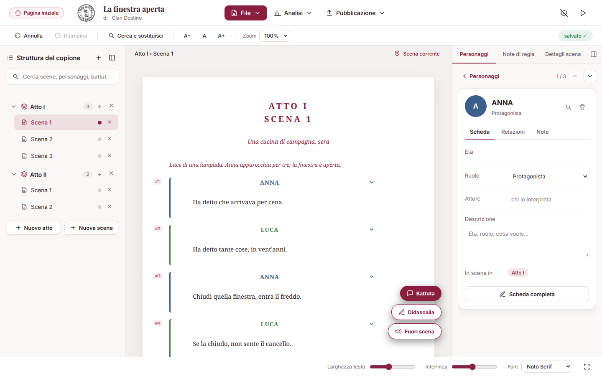
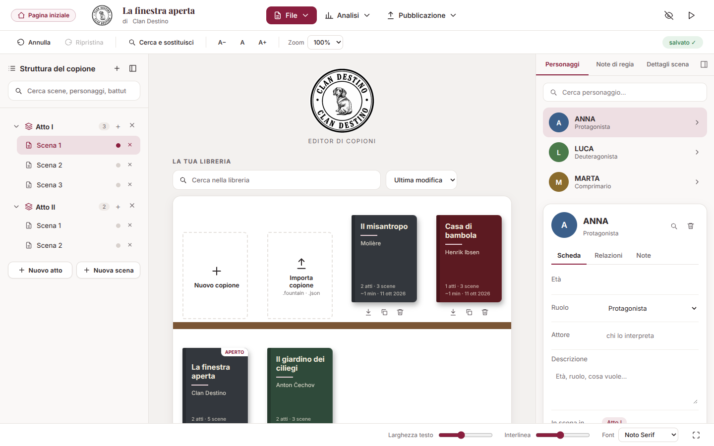
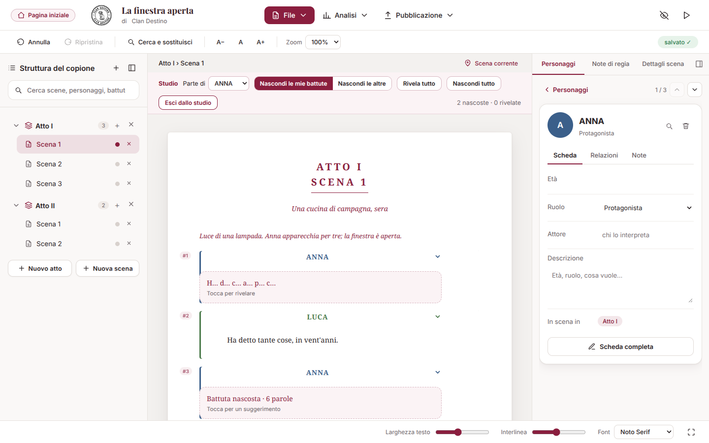
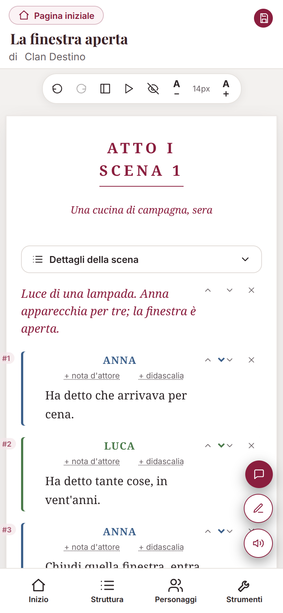
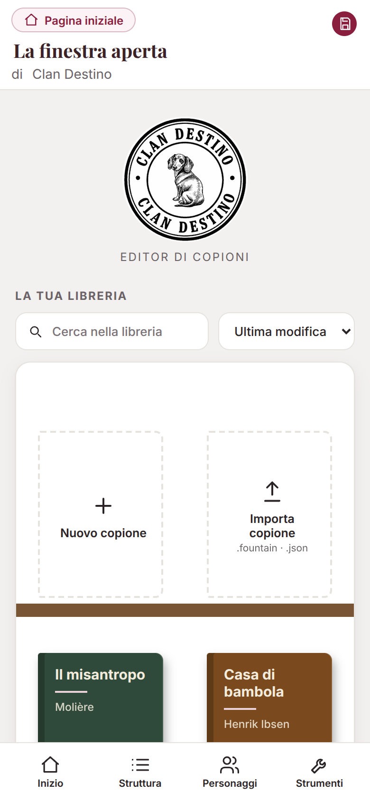

# Copione — Editor per il teatro

Un editor di copioni teatrali che funziona direttamente nel browser, in **un solo file HTML**: niente installazione, niente account, niente server. Scrivi atti, scene, battute e didascalie, gestisci i personaggi, esporti in PDF e in formato Fountain.

Creato da **Giampiero Santoro — Clan Destino**.

**▶ Provalo online:** https://giampiero-santoro.github.io/copione-teatrale/

> 📖 Per l'uso passo per passo vedi la [**Guida all'uso**](GUIDA.md). Le novità sono nell'[elenco delle modifiche](CHANGELOG.md).

## Com'è fatto



| La pagina iniziale con la libreria | La modalità studio |
|---|---|
|  |  |

<p>
  
  &nbsp;&nbsp;
  
</p>

*Gli esempi usano testi di fantasia e titoli di opere di pubblico dominio.*

---

## Cosa puoi fare

**Scrivere**
- Struttura in **atti e scene**, con luogo e momento di ogni scena.
- Tre tipi di blocco: **battuta**, **didascalia**, **voce fuori scena**, più note tra parentesi.
- **Personaggi** con scheda (età, ruolo, descrizione, relazioni, foto, colore) e filtro per vedere solo le loro battute.
- Dettagli di scena: stato (bozza / da rivedere / definitiva), descrizione, scenografia, personaggi in scena, **note di regia private**.
- Annulla/ripristina, cerca e sostituisci su tutto il copione, ricerca rapida (`Ctrl+K`).

**Organizzare**
- **Libreria** dei copioni nella pagina iniziale, a scaffali, con logo, ricerca, ordinamento e data dell'ultima modifica.
- Struttura con **atti comprimibili** e indicatore dello stato di ogni scena.
- **Versioni**: salva istantanee del copione e confrontale con quello attuale.
- Salvataggio automatico nel browser e, dove supportato, **collegamento a un file** sul tuo computer.
- **Backup dell'intera libreria** in un solo file (con le versioni), ripristino senza duplicati, **promemoria settimanale** e avviso se il copione è aperto in due schede.

**Importare ed esportare**
- Importa: testo incollato, file `.fountain`, progetti `.json`.
- Esporta: **PDF** (A4 o Letter, margini regolabili, copertina con logo opzionale), anteprima PDF anche **in tempo reale**, **copione per personaggio** (le sue battute con le battute-imbeccata), copia di lettura HTML, `.fountain`, `.txt`, progetto `.json`.

**Analizzare**
- Statistiche avanzate (tempo di lettura per atto, bilanciamento delle battute).
- Controllo qualità prima di stampare.
- Piano di scena: chi c'è in ogni scena.
- Vista d'insieme con anteprima di tutte le scene.

**Lavorare comodi**
- Un unico aspetto **chiaro e moderno**: carta bianca, accento bordeaux e copione in carattere con le grazie.
- Layout a tre pannelli su schermi larghi (menu in alto, struttura a sinistra, personaggi e dettagli a destra), con pannelli nascondibili.
- Versione ottimizzata per **smartphone**, con barra di navigazione in basso.
- **Installabile come app** sulla schermata Home di telefono e computer, con l'icona Clan Destino.
- **Accessibile**: uso completo da tastiera, contorno di focus visibile, etichette per i lettori di schermo, contrasti elevati e bersagli di tocco ampi.
- **Modalità prova/lettura** per leggere il copione senza gli strumenti di modifica.
- **Modalità studio**: nasconde le battute di un personaggio, con suggerimento a iniziali e rivelazione a tocco, per imparare la parte a memoria.

---

## Come si usa

### Online
Apri il link qui sopra. Non serve altro.

### In locale
1. Scarica `index.html` (pulsante *Raw* → *Salva con nome*, oppure clona il repository).
2. Aprilo con un doppio clic nel browser.

### Pubblicarlo con GitHub Pages
1. Carica `index.html` nella radice del repository (o in una cartella).
2. Vai su **Settings → Pages**.
3. In *Build and deployment* scegli **Deploy from a branch**, seleziona il branch `main` e la cartella `/ (root)`.
4. Dopo un minuto il sito è disponibile su `https://<utente>.github.io/<repository>/`.

Per aggiornare l'editor basta sostituire `index.html` e fare commit.

---

## I tuoi dati

- **Tutto resta sul tuo dispositivo.** Il copione non viene inviato a nessun server.
- Il salvataggio automatico usa la memoria del browser (`localStorage`). Svuotare la cache o i dati del sito, o cambiare browser/dispositivo, significa perdere i copioni salvati in questo modo.
- **Per sicurezza salva sempre anche un file:** *File → Scegli dove salvare* (browser basati su Chromium) oppure *Pubblicazione → Salva progetto (.json)*.
- La libreria è **per browser**: telefono e computer hanno librerie diverse. Per spostare un copione usa l'esportazione `.json` e poi *Importa copione*.

## Compatibilità

| Funzione | Chrome / Edge | Safari / Firefox | Telefono |
|---|---|---|---|
| Scrittura, esportazioni, importazioni | ✅ | ✅ | ✅ |
| Collegare un file sul computer (salvataggio diretto) | ✅ | ❌ (si usa *Salva progetto .json*) | ❌ |
| Layout a tre pannelli | ✅ (da ~1000 px di larghezza) | ✅ | layout dedicato |

Serve una connessione per caricare i caratteri di Google Fonts e una piccola libreria per i QR code (`qrcodejs`); senza connessione l'editor funziona comunque con caratteri di riserva.

## Scorciatoie da tastiera

| Tasti | Azione |
|---|---|
| `Ctrl/Cmd + S` | Salva subito |
| `Ctrl/Cmd + Invio` | Aggiunge una nuova battuta nella scena |
| `Ctrl/Cmd + Z` | Annulla |
| `Ctrl/Cmd + Maiusc + Z` oppure `Ctrl/Cmd + Y` | Ripristina |
| `Ctrl/Cmd + K` | Ricerca rapida (scene, personaggi, battute) |
| `Esc` | Chiude la finestra aperta |

## Formati

| Formato | Importa | Esporta | Contenuto |
|---|---|---|---|
| **Progetto `.json`** | ✅ | ✅ | Tutto: testo, schede personaggio, note di regia, impostazioni |
| **Fountain `.fountain`** | ✅ | ✅ | Titolo, autore, atti (`#`), scene (`##`), didascalie, battute. *Non* contiene schede personaggio né note di regia |
| **Testo `.txt`** | ✅ (incolla) | ✅ | Solo testo. Importando: righe in MAIUSCOLO = personaggi, righe tra (parentesi) = didascalie |
| **PDF** | — | ✅ | Copione completo o per personaggio |
| **HTML di lettura** | — | ✅ | Copia di sola lettura |

## Struttura del repository

```
├── index.html      # l'intero editor (HTML + CSS + JavaScript)
├── README.md       # questo file
├── GUIDA.md        # guida all'uso
├── CHANGELOG.md    # elenco delle modifiche
└── docs/           # screenshot usati nel README
```

L'editor è volutamente un unico file: per modificarlo basta un editor di testo e per distribuirlo basta copiarlo.

## Contribuire

Segnalazioni e idee sono benvenute: apri una *Issue* descrivendo cosa hai fatto, cosa ti aspettavi e cosa è successo (indica anche browser e dispositivo).

## Licenza

*Da definire.* Finché non viene aggiunto un file `LICENSE`, tutti i diritti sono riservati all'autore: il codice si può vedere, ma non riutilizzare o ridistribuire senza permesso.

Il **logo e il nome «Clan Destino»** sono marchi della compagnia e non sono ceduti con il codice, qualunque licenza venga scelta.

## Crediti

Autore: **Giampiero Santoro — Clan Destino**.

L'editor si appoggia a componenti di terzi, ciascuno con la propria licenza:

| Componente | Uso | Licenza |
|---|---|---|
| [jsPDF](https://github.com/parallax/jsPDF) 2.5.1 | creazione dei PDF | MIT |
| [qrcodejs](https://github.com/davidshimjs/qrcodejs) 1.0.0 | QR code nel PDF | MIT |
| [Google Fonts](https://fonts.google.com): Inter, Playfair Display, Courier Prime, Space Grotesk, Noto Serif | caratteri | SIL Open Font License |
| Icone lineari | interfaccia | disegnate a mano nello stile di [Lucide](https://lucide.dev) / [Feather](https://feathericons.com) (licenze ISC / MIT) |
